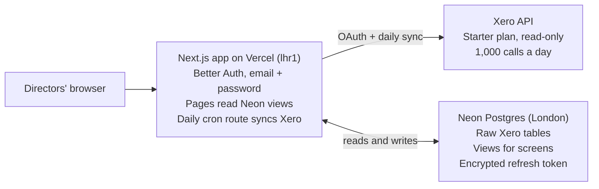

# fat-controller — Spec & Plan

12 October 2026

## Overview

fat-controller is Tandem's internal finance dashboard. It reads Tandem's own Xero organisation through the Xero API, caches the data in Neon Postgres, and shows the two directors cash, revenue, tax set-asides and take-home in one place.

**Goals**

- See cash position, money owed to us and money we owe, without logging into Xero.
- Track revenue and profit by client and project.
- Show a per-director take-home figure from the dividend distribution method.
- Flag VAT and other deadlines before they arrive.

**Non-goals (v1)**

- No writing back to Xero: read-only.
- No multi-tenant or client-facing use. One Xero organisation, two users.
- Not a replacement for the accountant's year-end accounts or tax advice; figures are management estimates.

## Users and access

Two users, both admins: the two directors. No self-sign-up.

- **Login:** Better Auth email and password sign-in only. No sign-up page: the two director accounts are created by the seed from the `DIRECTOR_ACCOUNTS` env var, with `DIRECTOR_INITIAL_PASSWORD` as the first password; each director changes it on the settings page.
- **Roles:** one role (director). Every page sees every figure. Revisit only if contractors ever need a view, which is not planned.
- **Xero connection:** one director authorises Xero once from a settings page; the app stores the refresh token server-side and keeps it alive.

## Xero integration

Register a new private app on the free **Starter** plan and connect it with the standard OAuth 2.0 authorisation-code flow. One organisation is one connection, so Tandem uses 1 of the 5 allowed and pays nothing ([Xero pricing](https://developer.xero.com/pricing)).

**Why not a Custom Connection:** Xero now treats Custom Connections (machine-to-machine, no user login) as a premium integration with its own ongoing subscription ([IT Brief](https://itbrief.co.nz/story/xero-expands-developer-tools-with-new-webhook-events)). Not worth paying for when one director can authorise once.

**Constraints that shape the design**

| Constraint        | Starter plan                                                    | Design response                                                                    |
| ----------------- | --------------------------------------------------------------- | ---------------------------------------------------------------------------------- |
| API calls         | 1,000 per day per organisation                                  | Sync incrementally with `If-Modified-Since`; never call Xero on page load          |
| Journals endpoint | Not available (Advanced plan only)                              | Build figures from invoices, payments, bank transactions and the Reports endpoints |
| Scopes            | Granular scopes only for apps created after 2 March 2026        | Request the read-only scopes listed below                                          |
| Data use          | API data may not be used to train AI or machine-learning models | Fine for dashboards; note it if an AI summary feature is ever added                |
| Refresh token     | Expires if unused for about 60 days (approximate, check docs)   | Daily sync keeps it alive; alert if refresh fails                                  |

**Scopes (all read-only)** ([granular scopes](https://devblog.xero.com/upcoming-changes-to-xero-accounting-api-scopes-705c5a9621a0))

- `openid profile email offline_access`
- `accounting.invoices.read`, `accounting.payments.read`, `accounting.banktransactions.read`, `accounting.manualjournals.read`
- `accounting.contacts.read`, `accounting.settings.read`
- `accounting.reports.profitandloss.read`, `accounting.reports.balancesheet.read`, `accounting.reports.banksummary.read`, `accounting.reports.aged.read`

**Endpoints used:** Organisation, Accounts, TrackingCategories, Contacts, Invoices (sales and bills), CreditNotes, Payments, BankTransactions, ManualJournals, and Reports (ProfitAndLoss, BalanceSheet, BankSummary, AgedReceivablesByContact, AgedPayablesByContact).

**VAT note:** the tax-reports scope covers Australian and New Zealand returns only. UK VAT is estimated from the tax amounts on synced invoices and bills, and checked against Xero's VAT return before filing.

## Dashboards and metrics

The home screen is a **monthly P&L** (profit and loss): for each month, what came in from sales, what went out on people, and what's left. Everything else hangs off it. Every figure shows its as-of time and links through to the Xero records behind it.

**Monthly P&L (home)**

One row per month, last 12 months plus the current month to date, with a bar chart of sales against people costs above it.

| Column       | Meaning                                                              |
| ------------ | -------------------------------------------------------------------- |
| Sales        | Invoiced revenue, excluding VAT                                      |
| People costs | Salaries, employer National Insurance, pension, and contractor bills |
| Other costs  | Hosting, software, accountancy and everything else                   |
| Profit       | Sales minus all costs                                                |
| Margin       | Profit as a % of sales                                               |

**Source:** our own synced transactions, not Xero's Profit and Loss report: sales invoices, bills, credit notes, bank spend and receive lines, and posted manual journals, each line by account (`v_ledger_line`). Each Xero account is mapped once to Sales, People costs or Other costs in an `account_group` settings table, so the grouping matches how we think about the business, not Xero's chart of accounts. On Tandem's data this reproduces Xero's P&L exactly per account per month (checked 2026-10-12); payroll here reaches the ledger as bank transactions. If payroll ever posts through Xero Payroll journals (not visible on the Starter plan), the gap would show as a difference from Xero's report.

**Other screens**

| Screen              | What it shows                                                                                                                              |
| ------------------- | ------------------------------------------------------------------------------------------------------------------------------------------ |
| **Clients**         | Amount invoiced and paid per client, per month and per financial year; share of total revenue; outstanding balance and average days to pay |
| **Cash**            | Bank balance over time; money owed to us and money we owe                                                                                  |
| **Tax & take-home** | Per-director take-home to date, VAT estimate for the open quarter                                                                          |
| **Costs**           | People and other costs by account and supplier, with monthly run rate of subscriptions                                                     |

**Take-home rule:** run the dividend distribution method and show the per-director figure only. The method's parameters live in a settings table so they can change without a deploy. The app shows no Corporation Tax figures (see Decisions).

**Deadlines panel:** VAT quarter end and filing date, confirmation statement, year-end. Dates are entered once in settings; the app counts down and flags anything inside 30 days.

## Architecture

One Next.js app on Vercel does everything: login, pages, and the daily Xero sync. Neon holds the data.



The browser never touches Xero or the database; only server code does.

Built with the `/ludwig-vercel` skill.

- **App:** latest Next.js (App Router, Server Components), React, TypeScript strict, pnpm. Data loads in Server Components so queries stay server-side.
- **UI:** Tailwind CSS 4 and shadcn/ui, with its chart components for the graphs.
- **Auth:** Better Auth, email and password, database sessions, sign-in only, no sign-up.
- **Database:** Postgres through Drizzle ORM and the `pg` driver: Docker locally, Neon (aws-eu-west-2) in production via the Vercel Marketplace. Functions run in `lhr1`, next to the database.
- **Validation and tests:** Zod 4 for env and Xero responses; Vitest for the P&L grouping, take-home and VAT calculations.
- **Deploys:** public GitHub repo `TandemCreativeDev/fat-controller` (public because Vercel Hobby can't deploy private org repos; no secrets or company data live in the repo); every push to `main` runs migrate, seed and build on Vercel.

## Data model

Three layers in Neon Postgres, managed with Drizzle ORM migrations (Docker Postgres 17 locally, Neon in production, the `pg` driver for both): raw Xero records, derived views the dashboards read, and app-owned settings. Raw tables keep the full Xero JSON in a `raw jsonb` column beside the typed columns, so a new metric never needs a re-sync.

| Table                   | Layer | Key columns                                                                                                                |
| ----------------------- | ----- | -------------------------------------------------------------------------------------------------------------------------- |
| `xero_connection`       | App   | tenant_id, refresh token encrypted with an app key, token expiry, scopes, last refresh                                     |
| `sync_run`              | App   | resource, started_at, finished_at, rows changed, API calls used, error                                                     |
| `sync_cursor`           | App   | resource, last `UpdatedDateUTC` seen                                                                                       |
| `xero_account`          | Raw   | account_id, code, name, type, tax type                                                                                     |
| `xero_contact`          | Raw   | contact_id, name, is_customer, is_supplier                                                                                 |
| `xero_invoice`          | Raw   | invoice_id, type (sales or bill), contact_id, date, due_date, status, subtotal, tax, total, amount_due, currency, tracking |
| `xero_invoice_line`     | Raw   | invoice_id, account_code, amount, tax_amount, tracking option                                                              |
| `xero_payment`          | Raw   | payment_id, invoice_id, date, amount, bank account                                                                         |
| `xero_bank_transaction` | Raw   | id, type (spend or receive), date, contact_id, total, account_code                                                         |
| `xero_report_snapshot`  | Raw   | report name, period, fetched_at, `raw jsonb`                                                                               |
| `account_group`         | App   | maps each Xero account to Sales, People costs or Other costs                                                               |
| `project_map`           | App   | maps a Xero contact or tracking option to a Tandem project                                                                 |
| `settings`              | App   | Dividend method parameters, financial year start, deadline dates                                                           |

**Views:** `v_pnl_monthly`, `v_cash_daily`, `v_revenue_by_client_month`, `v_aged_debtors`, `v_take_home_ytd`, `v_vat_open_quarter`. Dashboards query views only, never raw tables, so a calculation lives in one place.

**Money:** store amounts as `numeric(14,2)` in GBP. Foreign-currency invoices keep Xero's converted base-currency amount alongside the original.

## Sync design

A daily scheduled sync pulls only what changed since the last run; pages never call Xero directly. Webhooks wait until v2: daily data plus a manual refresh button is enough for monthly figures, and polling is simpler to make reliable.

1. **Backfill (once):** pull every record since Tandem's incorporation, resource by resource, paging 100 at a time. Pause at 50 calls per minute to stay under Xero's per-minute limit. Expect a few hundred calls in total.
2. **Daily incremental:** for each resource, send `If-Modified-Since` set to its `sync_cursor`, upsert the changed rows, advance the cursor. Roughly 10 calls a run, well inside 1,000 a day.
3. **Reports nightly:** fetch P&L, Balance Sheet, Bank Summary and aged reports once a night into `xero_report_snapshot`.
4. **Manual refresh:** a button in settings runs step 2 now, rate-limited to once every 5 minutes.
5. **Token handling:** refresh the access token before each run (it lasts 30 minutes); write the new refresh token back in the same transaction, because each one can only be used once.
6. **Failure:** each run writes a `sync_run` row. Two failures in a row, or a refresh-token error, sends an email to both directors and shows a banner.

**Runtime:** a Next.js route handler, `/api/cron/sync`, called once a day by a Vercel Cron Job and by the manual refresh button, protected by a `CRON_SECRET` bearer token. The free Hobby plan only allows daily crons ([Vercel](https://vercel.com/docs/cron-jobs/usage-and-pricing)); hourly needs Pro. The backfill runs through the same route in resumable chunks, one resource per call with its cursor saved, so no call hits the function time limit and nothing local ever touches Neon.

## Security and compliance

The app holds Tandem's full financial record, so it sits inside the existing Cyber Essentials scope.

- **Data location:** Neon project in the London region (AWS eu-west-2). Company financial data only; contact names and emails from Xero are the only personal data, kept under the same UK GDPR position as other Tandem systems.
- **Access:** no public database access. Only the Next.js server holds `DATABASE_URL`, and every page checks for a signed-in director.
- **Secrets:** Xero client secret, `DATABASE_URL`, `CRON_SECRET`, `BETTER_AUTH_SECRET` and the token encryption key live in Vercel environment variables, never in the repo or the browser. The refresh token is stored encrypted.
- **Read-only scopes:** the app cannot change anything in Xero, even if compromised.
- **Auth:** Better Auth email and password, database sessions and database-backed rate limiting on sign-in; sessions expire after 7 days.
- **No AI training:** no Xero data goes to model training, per Xero's terms.

## Delivery plan

Four milestones; each ends with something both directors can use. Dates to be set once v1 effort is agreed.

1. **M0, live on day one:** Next.js scaffold, Docker Postgres, GitHub repo, Vercel in lhr1 with Neon from the Marketplace, migrate and seed on every build, Better Auth, settings page. Ends with a live production URL.
2. **Xero connect and sync:** register the Starter app, OAuth connect flow, token storage, chunked backfill, daily cron sync, `sync_run` log and failure emails. Test first against Xero's demo company.
3. **Core dashboards:** Monthly P&L (home), Clients, and Tax & take-home, built on the views. Check take-home figures against the last two manual calculations before trusting them.
4. **Depth:** client-to-project mapping with `project_map`, Cash, Costs, deadlines panel, nightly report snapshots.

**Later (v2):** Xero webhooks for near-real-time invoices, Solidtime hours joined to revenue for effective hourly rate per project, monthly PDF summary for the accountant.

## Technical detail

**Pinned versions:** Next.js 16.4.0, React 19.3.0, Drizzle ORM and drizzle-kit 1.0.0-rc.4 (exact pins: pre-release), Better Auth 1.7, Zod 4, Tailwind CSS 4, shadcn/ui (base-nova style on Base UI), Vitest 5. Node 24 types; pnpm.

**Source layout**

```
src/
  app/            routes. (app)/ = signed-in pages; sign-in/; api/auth, api/health, api/cron (M1)
  components/ui/  shadcn components
  db/             pool + drizzle client (index.ts), schema/ (auth.ts, app.ts, xero.ts later)
  lib/            pure logic (settings, directors, later pnl/take-home/vat) + server-only stores
  env.ts          Zod-validated environment, baseUrl, trustedOrigins
  proxy.ts        optimistic signed-out redirect
scripts/          seed.ts (idempotent), gates.sh
drizzle/          generated migrations (never edit once pushed)
```

**Environment variables**

| Name                                                                          | Where              | Purpose                                                 |
| ----------------------------------------------------------------------------- | ------------------ | ------------------------------------------------------- |
| `DATABASE_URL`                                                                | all                | pooled connection (Neon pooler in prod, Docker locally) |
| `DATABASE_URL_UNPOOLED`                                                       | build, drizzle-kit | direct connection for migrations                        |
| `BETTER_AUTH_SECRET`                                                          | all                | session signing (sensitive)                             |
| `BETTER_AUTH_URL`                                                             | production, local  | canonical origin; previews derive it from `VERCEL_URL`  |
| `DIRECTOR_ACCOUNTS`                                                           | seed               | `Name <email>, Name <email>`                            |
| `DIRECTOR_INITIAL_PASSWORD`                                                   | seed               | first password for new director accounts (sensitive)    |
| `XERO_CLIENT_ID`, `XERO_CLIENT_SECRET`, `TOKEN_ENCRYPTION_KEY`, `CRON_SECRET` | M1                 | Xero OAuth, refresh-token encryption, cron auth         |

**Auth flow:** `proxy.ts` redirects requests without a session cookie to `/sign-in`; every page and server action calls `requireDirector()`, which validates the session against the database. Sign-in and password change run client-side through `/api/auth` so Better Auth's database-backed rate limiter applies (5 per minute).

## Design system

Shadcn base-nova defaults on the neutral palette, Geist Sans and Geist Mono, light and dark through `next-themes`. A finance tool, so the goals are density and legibility: tabular numerals for money, right-aligned figure columns, negative amounts in the destructive colour, every figure with an as-of time. No decorative imagery or gradients. The chart palette uses the `--chart-*` tokens. Revisit only if Tandem's brand needs to show.

## Quality bar

- `pnpm gates` (typecheck, lint, Vitest, build) passes before every push.
- Money logic (P&L grouping, take-home, VAT) is pure and unit-tested against hand-computed fixtures before any UI uses it.
- No figure on screen is computed in a component; it comes from a view or a tested function.

## Decisions

- **2026-10-12** Source lives under `src/`; the `@/*` alias maps to `src/*`.
- **2026-10-12** Cache Components stays **off**. Every page is private and per-request, so there's nothing to prerender; revisit if pages get slow.
- **2026-10-12** Drizzle 1.0 rc.4 (pinned) for `drizzle-orm/zod`; Better Auth 1.7 supports `>=1.0.0-rc.1`.
- **2026-10-12** Settings are a key → jsonb table, validated by a typed registry (`src/lib/settings.ts`). Invalid stored values fall back to defaults instead of breaking pages.
- **2026-10-12** Director identities and the initial password come from env vars, not the repo, because the repo is public. The seed never overwrites an existing password.
- **2026-10-12** The repo is public (Vercel Hobby, TandemCreativeDev org). Nothing company-specific goes into code, fixtures or seed data; client names and mappings are entered in the app.
- **2026-10-12** Main-only deploys; no preview environments for now.
- **2026-10-12** `/api/health` is public and returns only `{ ok }`.
- **2026-10-12** The P&L is built from synced transactions (`v_ledger_line`), not Xero's P&L report (director's call). The report is no longer fetched; `xero_pnl_line` and `xero_report_snapshot` stay until a later migration drops them.
- **2026-10-12** Directors' Remuneration counts as People costs.
- **2026-10-12** The main measure everywhere is Sales invoiced, by invoice date: Tandem invoices as soon as work is done, so invoice date measures work delivered. Cash received is secondary and never sits beside Sales month by month; no "Cash in" column on the P&L. Rolling 3-month averages of Sales and Profit use complete months only. No billable-days tracking.
- **2026-10-12** No Corporation Tax anywhere in the app: no set-aside figure, rate setting or CT deadline (director's call). `v_pnl_monthly.ct_set_aside` is no longer read and is dropped in a later migration; the stored `ct_set_aside_rate` setting is ignored.

## Open questions

- [ ] How are projects tagged in Xero today: by contact, by tracking category, or not at all?
- [ ] Is payroll run in Xero, or somewhere else that posts into it?
- [ ] Which parameters does the dividend distribution method need (salary level, split, timing) so it can live in `settings`?
- [ ] Is a daily sync enough, or is hourly worth Vercel Pro ($20 per member a month)?
- [ ] Does the accountant want read access, or a monthly export instead?
- [ ] Target date for v1?
